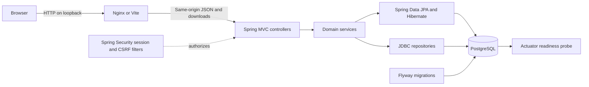
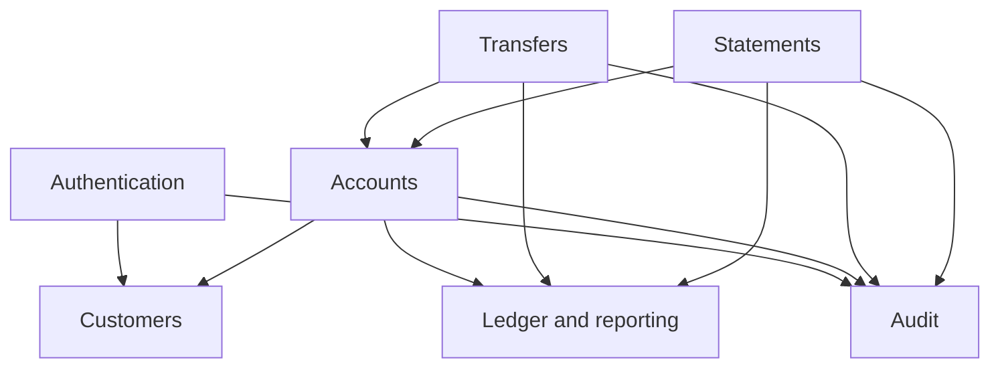

# System architecture

The reverse proxy forwards HTTP to the backend over the Compose network. Spring Security checks the session and mutation token before a controller runs. DTOs define the public request and response shapes. Profiles and accounts use JPA to map rows to durable domain objects. Posting and reporting use bound SQL for explicit commit checks, aggregates and cursor controls.

## Module dependencies

The funding service sits in Accounts and uses the same ordered locking and ledger post primitive as Transfers. A ledger query cannot start a transfer or create an account. The Audit module never calls back into a financial service.
