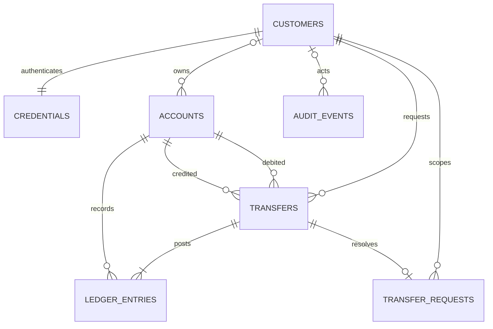

# PostgreSQL schema

Flyway applies migrations before Hibernate validates mapped tables. The customer UUID doubles as the primary key of its sole credential. Canonical email has a unique constraint. The system account has a null customer ID and a restricted type. A customer account is opened active and starts with no ledger entries. Closed accounts retain their historical data and cannot send or receive transfers. There is no customer-initiated closure workflow.

The ledger stores positive `numeric(19,2)` amounts and a separate direction for every entry. Balance is the sum of credits minus debits. There is no cached balance to reconcile. Transfer references, account IDs and audit event identifiers are UUIDs. The posting timestamp comes from PostgreSQL and is shared by the two ledger entries. The API reports UTC instants.

The composite key `(requester_id, request_key)` makes idempotency customer-scoped. Its foreign key to the posting is deferred until commit, allowing the key to be claimed first. A database trigger rejects incomplete or mismatched posting pairs. Financial foreign keys restrict deletion, and write guards reject updates, deletes and truncation of transfers, ledger entries and posted idempotency mappings. An operator with schema ownership can change those guards. Separate application and migration roles are a deployment consideration.

The account/time/ID index supports sorted ledger queries with a stable tie-breaker. A partial unique index limits demo funding to a single posting per destination. Additional application-level checks enforce the source owner, account status, supported currency and spending limit.

A financial correction requires a new compensating posting. The app exposes internal transfers and the fixed grant, with no privileged workflow for formal reversals.
