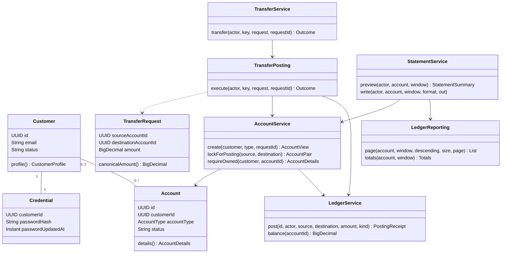

# Domain class diagram

The relationships between Customer, Credential and Account are database relationships represented by IDs. Public API records contain selected immutable values. With that design, JSON serialization has a bounded shape and does not recursively walk JPA entity graphs.
