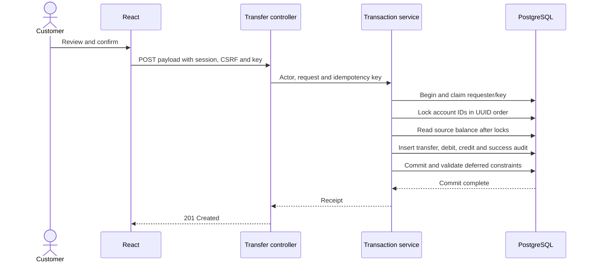
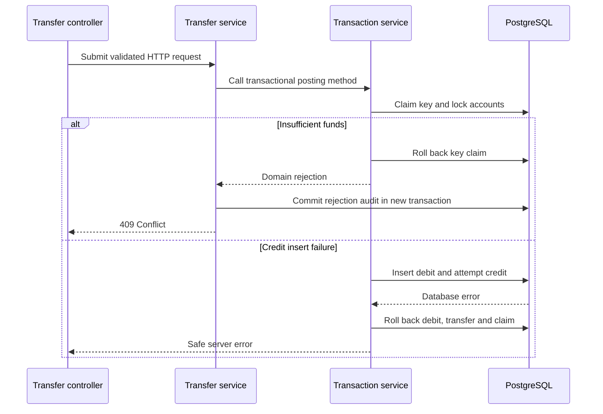

# Transfer sequences

## Successful posting

## Rejection and rollback

A matching replay returns HTTP 200 with the original receipt. An incompatible payload for that key returns HTTP 409. A transfer-key lookup that returns HTTP 404 has found no committed receipt yet. An in-flight request can still commit, so any retry preserves the original key and details.
